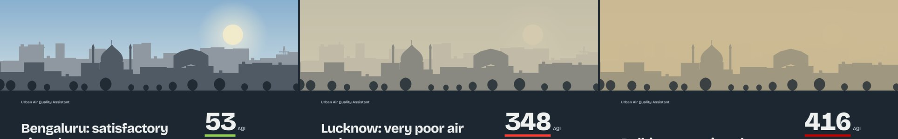
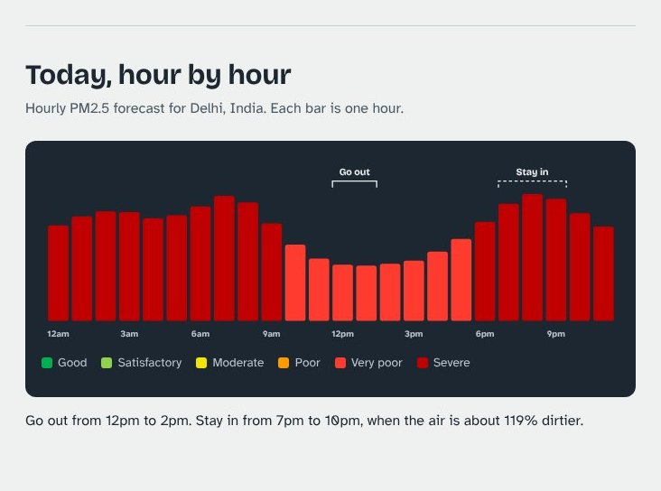
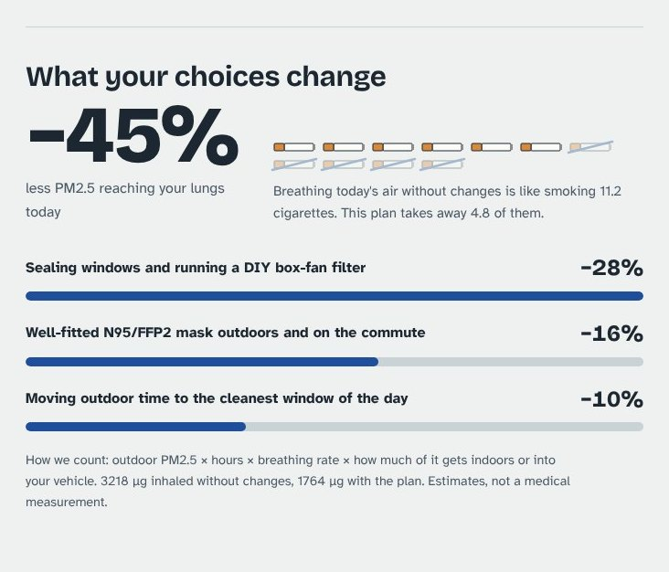
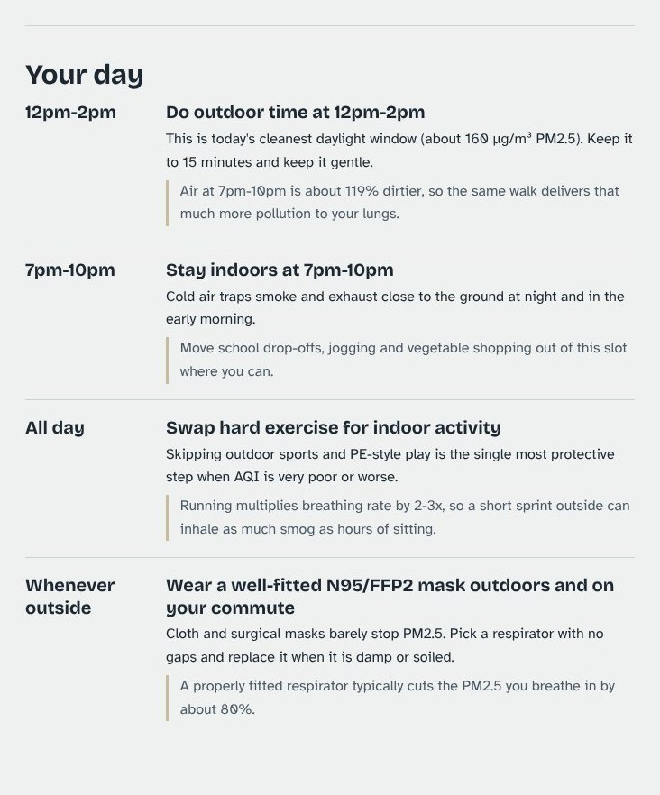
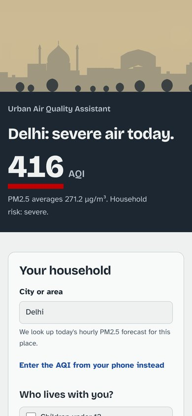
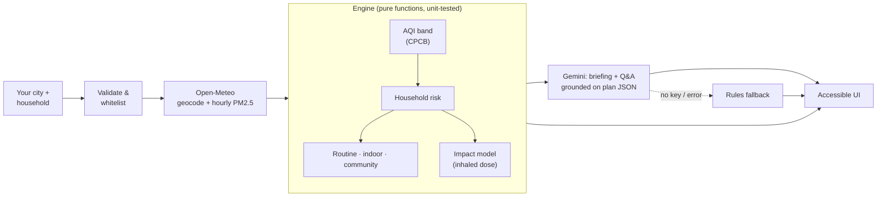

<div align="center">



# Urban Air Quality Assistant

**Type your city and who lives with you. Get today's smog hour by hour, a plan for your household, and how much each choice cuts what you breathe.**

[**Open the live app**](https://urban-air-assistant-nine.vercel.app) &nbsp;·&nbsp; [How it decides](#how-it-decides) &nbsp;·&nbsp; [Run it locally](#run-it-locally)

[](https://urban-air-assistant-nine.vercel.app)
[](test)
[](#accessibility)
[](src/services/llm.js)
[-1c2731?style=flat-square>)](package.json)
[](LICENSE)

</div>

---

**Vertical:** [Challenge 6] Urban Air Quality Assistant

Every November the same question goes round North-Indian family WhatsApp groups: _is it safe to send the kids out?_ AQI apps show one red number for the whole day and stop there. That number hides most of what a family needs to know:

- **The air changes through the day.** In winter, PM2.5 builds up overnight, thins out after lunch, and settles again in the evening. The same walk at 2 pm and at 8 pm can deliver twice the dose.
- **Not every household is equally at risk.** A home with a child who has asthma needs different advice from two healthy adults who work from home.
- **Advice without numbers is easy to ignore.** "Wear a mask" lands differently when you can see it removes 16% of what your family breathes today.

This assistant answers all three, for your city, today.

## What you get

<table>
<tr>
<td width="50%" valign="top">

**Today, hour by hour.** A 24-bar strip of the live PM2.5 forecast, coloured with the official CPCB AQI bands. It marks when to go out and when to stay in.



</td>
<td width="50%" valign="top">

**What your choices change.** The percentage drop in PM2.5 reaching your lungs, the same figure as cigarettes you don't have to "smoke", and what each step is worth on its own.



</td>
</tr>
<tr>
<td valign="top">

**Your day, by time.** The routine is laid out against the clock: when to go out, when to stay in, and what to do all day. Each step says why it matters.



</td>
<td valign="top">

**Plus:**

- An indoor checklist, cheapest fix first: seal gaps, ventilate at the clean hour, run a purifier or build a ~₹1,500 box-fan filter, and fix kitchen and heating smoke.
- Community actions with kg of CO₂ saved per week, and an honest note on what switching your commute does to _your own_ exposure.
- A Gemini-written briefing, plus follow-up Q&A that only uses your plan's numbers.
- The skyline at the top fades and disappears as the real AQI rises.



</td>
</tr>
</table>

## How it decides

A deterministic engine produces every number and every recommendation. Google Gemini then turns the plan into a short spoken-style briefing and answers questions about it. The model never makes up a figure; it only explains the plan.



### Context changes the advice

| What we know                                                  | What changes in your plan                                                                                                                     |
| ------------------------------------------------------------- | --------------------------------------------------------------------------------------------------------------------------------------------- |
| **Air quality band** (CPCB Good → Severe)                     | Base risk, and which measures switch on. On a clean day it just says "go about your day".                                                     |
| **Asthma/COPD/heart, children, 65+, pregnancy, outdoor work** | Risk rises by up to two tiers (never on a clean day). Adds indoor play for kids, reliever medication, and scheduling heavy work.              |
| **Hourly forecast**                                           | Finds the cleanest 2-hour daylight window to go out, and the dirtiest 3-hour window to stay in.                                               |
| **Commute + distance**                                        | Mask advice. Switch options show CO₂ saved _and_ the personal-exposure trade-off. It never suggests cycling on severe days or for long rides. |
| **Cooking fuel, heating**                                     | Chimney and exhaust advice, clean-cooking schemes, and replacing wood or coal fires.                                                          |
| **Owns a purifier?**                                          | "Run it in the bedroom with the door shut" instead of "build a box-fan filter".                                                               |

### The impact model

For each part of the day (commute, time outdoors, time indoors), inhaled PM2.5 is:

$$\text{dose} = C_\text{outdoor}(t) \times \text{infiltration} \times \text{breathing rate} \times \text{hours}$$

We simulate a "no changes" day and a "with this plan" day, then score each step on its own so you can see which one matters most. Exposure is turned into cigarettes using the Berkeley Earth rule of thumb (≈22 µg/m³ over 24 h ≈ 1 cigarette a day).

## Built to be judged

| Criterion             | What we did                                                                                                                                                                                                                                                                                                                                                                                                                                                                                                                       | Where                                                                                                                                              |
| --------------------- | --------------------------------------------------------------------------------------------------------------------------------------------------------------------------------------------------------------------------------------------------------------------------------------------------------------------------------------------------------------------------------------------------------------------------------------------------------------------------------------------------------------------------------- | -------------------------------------------------------------------------------------------------------------------------------------------------- |
| **Problem alignment** | Covers routines, indoor hacks and sustainable alternatives, tailored to location and household, with a number for the impact of every choice                                                                                                                                                                                                                                                                                                                                                                                      | [`src/engine/`](src/engine)                                                                                                                        |
| **Code quality**      | Single-responsibility modules: routes, validation, errors, config, services and a pure engine. A composition root injects every dependency (`fetchImpl`, `now`, `assistant`, `airQualityForCity`). Routine advice is a declarative rule table, so new advice means a new rule, not a new branch. ESLint (complexity and parameter caps), Prettier, and a `tsc --checkJs` type-check over JSDoc types. Every limit lives in one config file. One runtime dependency.                                                               | [`src/`](src), [`src/config.js`](src/config.js), [`eslint.config.js`](eslint.config.js)                                                            |
| **Security**          | Strict CSP (no inline JS or CSS, `object-src 'none'`), HSTS, `nosniff`, `DENY` and CORP headers. `Cache-Control: no-store` on every API response. Cross-site POSTs get 403 (Origin check), and non-JSON bodies get 415. Per-IP rate limits, tighter on the paid GenAI endpoints. 16 kB body cap. Enum whitelists and range checks. Unexpected errors are hidden behind a generic 500. DOM built with `textContent` only. Gemini key sent in a header, read from env only, with a prompt-injection guard. No personal data stored. | [`src/middleware/security.js`](src/middleware/security.js), [`src/routes/api.js`](src/routes/api.js), [`src/services/llm.js`](src/services/llm.js) |
| **Efficiency**        | No framework and no build step; about 35 kB of first-party JS and CSS. Bounded 15-minute cache for upstream calls, and a timeout on every network request. Fonts are self-hosted subsets.                                                                                                                                                                                                                                                                                                                                         | [`src/services/airQuality.js`](src/services/airQuality.js)                                                                                         |
| **Testing**           | 69 `node:test` tests with no test dependencies. Coverage gates enforced in CI: ≥95% lines and functions, ≥85% branches; currently 99.7% lines. Covers AQI maths, validation, risk tiers, impact invariants, every routine rule, network failures, LLM fallback and sanitising, the HTTP API (400/403/404/413/415/429/502), security headers, the error handler, and the frontend helpers. CI runs lint, format, type-check and coverage on Node 22 and 24.                                                                        | [`test/`](test), [`.github/workflows/ci.yml`](.github/workflows/ci.yml)                                                                            |
| **Accessibility**     | axe-core finds no WCAG 2.2 AA violations in light or dark mode. Skip link, labelled fieldsets, 44 px targets, visible focus, live regions, a chart with a title and text description, `prefers-reduced-motion`, `forced-colors`, and Atkinson Hyperlegible body type.                                                                                                                                                                                                                                                             | [`public/`](public)                                                                                                                                |

## Accessibility

- **Typeface:** body text is set in **Atkinson Hyperlegible**, designed by the Braille Institute for low-vision readers. Headings use Bricolage Grotesque.
- **Colour:** the hourly chart sits on a dark panel so every CPCB band colour keeps 3:1 contrast. Each bar is also described in text, so colour is never the only signal.
- **Keyboard:** everything is reachable by keyboard. Status updates and answers are announced by screen readers.

## Run it locally

Requires Node.js 22+.

```bash
git clone https://github.com/GamerxD01/urban-air-assistant
cd urban-air-assistant
npm install
npm run verify  # lint + format + type-check + 69 tests with coverage thresholds
npm start       # http://localhost:3000
```

Gemini is optional. Without a key the app uses its built-in rules narrator, so it still works offline:

```bash
export GEMINI_API_KEY=your_key        # never commit it; see .env.example
export GEMINI_MODEL=gemini-3.8-flash
npm start
```

### Scripts

| Command                                                       | What it does                            |
| ------------------------------------------------------------- | --------------------------------------- |
| `npm start`                                                   | Run the server on port 3000             |
| `npm test`                                                    | Run all tests                           |
| `npm run coverage`                                            | Tests with enforced coverage thresholds |
| `npm run lint` / `npm run format:check` / `npm run typecheck` | ESLint, Prettier, `tsc --checkJs`       |
| `npm run verify`                                              | Everything above, as CI runs it         |

### API

| Method | Path          | Body                                       | Returns               |
| ------ | ------------- | ------------------------------------------ | --------------------- |
| `GET`  | `/api/health` | –                                          | `{ ok, genai }`       |
| `POST` | `/api/plan`   | `{ city?, aqi?, pm25?, profile }`          | `{ plan, narration }` |
| `POST` | `/api/ask`    | same as `/plan` + `{ question, history? }` | `{ answer }`          |

```jsonc
// profile
{
  "household": { "children": true, "elderly": false, "respiratory": true, "pregnant": false, "outdoorWorker": false },
  "lifestyle": { "commute": "car", "commuteKm": 12, "cooking": "lpg", "heating": "wood_coal", "hasPurifier": false },
}
```

### Project layout

```
api/index.js              Vercel serverless entry (wraps the Express app)
server.js                 Local / long-running entry
src/
  createApp.js            Composition root: middleware, routes, services
  config.js               Every limit, timeout and rate budget in one place
  errors.js               HttpError hierarchy (400/403/415/502...)
  validation.js           Request parsing and whitelisting
  sanitize.js             Untrusted-text normaliser (prompt-injection guard)
  routes/api.js           /api/health, /api/plan, /api/ask
  middleware/             Security headers, origin/JSON guards, rate limits, error handler
  services/               Open-Meteo client (cached), Gemini client (grounded), plan service
  engine/                 Pure decision engine: aqi, profile, risk, impact, recommendations, plan
public/                   UI: vanilla JS modules, CSS, self-hosted fonts, SVG skyline
  format.js               DOM-free UI helpers (unit-tested)
test/                     engine, services, modules, security, api, frontend
```

### Deployment

The app runs on Vercel. `public/` is served by the CDN, and `api/index.js` runs the same Express app as a single function. `vercel.json` adds the security headers to static files. Set `GEMINI_API_KEY` in the project environment to switch on Gemini. `render.yaml` is included if you'd rather run a long-lived Node server.

## Assumptions

- **Pollutant:** PM2.5 drives the plan, because it dominates North-Indian winter smog. AQI uses the **Indian CPCB** PM2.5 breakpoints.
- **Live data:** **Open-Meteo Air Quality** (Copernicus CAMS forecast). If you only enter an AQI, the hourly shape comes from a typical winter day, and the UI says so.
- **Impact constants:** rounded literature values, for illustration and not clinical use:
  - **Masks:** a well-fitted N95/FFP2 lets about 20% through in real-world use.
  - **Indoor/outdoor ratio:** 0.85 typical; 0.55 with windows sealed and a DIY filter; 0.35 sealed with a HEPA purifier. Car cabin 0.6, bus or metro 0.8.
  - **Breathing rate (m³/h):** 0.5 resting, 1.3 walking, 1.9 cycling.
  - **Tailpipe CO₂ per passenger-km:** car 0.17, carpool 0.085, two-wheeler 0.045, bus or metro 0.035. Five commuting days a week.
- **Medical:** this is general wellbeing guidance. The app always tells people to see a doctor if symptoms appear.

## License

MIT. Fonts are under the SIL Open Font License (see [`public/fonts`](public/fonts)).
